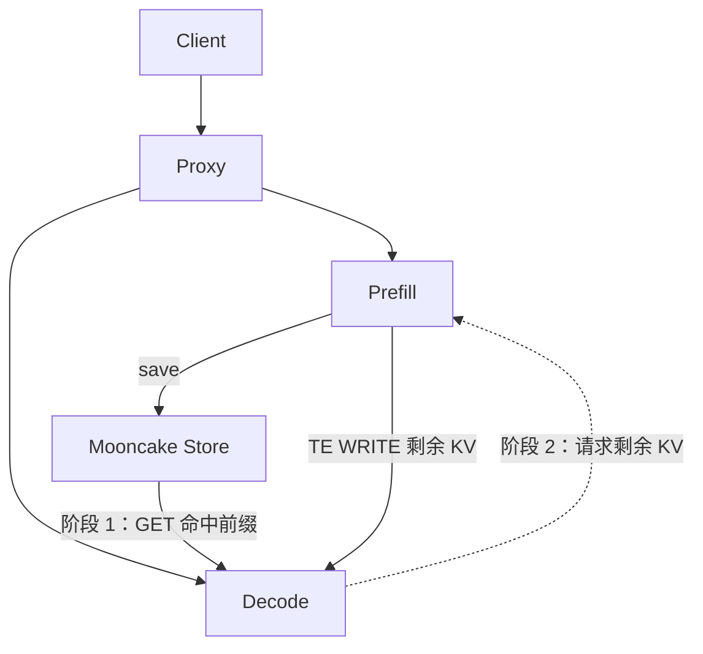

# MTSC

MTSC 是一个基于 Mooncake Store 和 Transfer Engine（TE）的两阶段 PD KV 传输组件：Decode 先从 Store 加载命中的前缀，再从 Prefill 拉取剩余 KV。

## 整体架构




更完整的状态机和协议说明见 [`docs/design`](./docs/design)。


`mtsc/` 保持 7 个核心模块（另有包入口 `__init__.py`）：

```text
mtsc/
  __init__.py
  connector.py
  scheduler.py
  worker.py
  protocol.py
  kv_cache_pool.py
  kv_transfer.py
  utils.py
```

- `mtsc.connector.MTSCConnector`：vLLM 外部 KV Connector 入口，P/D 共用同一个实现。
- `mtsc.scheduler.MTSCScheduler`：执行 Store lookup、KV block 分配和请求生命周期管理。
- `mtsc.worker.MTSCWorker`：驱动两阶段加载状态机：Store `[L,A)`，然后 PD `[A,T)`。
- `mtsc.protocol`：Scheduler/Worker 共用的 metadata，以及 P/D 请求与响应协议。
- `mtsc.kv_cache_pool`：`KVCachePool` 接口及 `MooncakeKVCachePool` 实现，包含 lookup RPC、官方 Store key、内存注册、异步 load/save 和 pending save 合并。
- `mtsc.kv_transfer`：`KVTransfer` 接口及 `MooncakeKVTransfer` 实现，包含 bootstrap、TP/DP 映射、MLA 支持、源会话管理和 TE WRITE。
- `mtsc.utils`：共享设备事件、内存区域和 KV 布局转换工具。
- `proxy.pd_proxy`：同时向 Prefill 和 Decode 发起请求，并向两侧传递同一个 `transfer_id`。

两个 Mooncake 类直接实现各自的接口；后端创建与配置校验放在 Worker 的私有工厂函数中。


## 快速使用

以下为同机双 GPU 示例，分别在独立终端执行；将 `/path/to/model` 替换为实际模型路径。
需先安装兼容的 vLLM 和 Mooncake，并将 `mooncake_master` 加入 `PATH`。
P/D 和 Proxy 终端先设置：

```bash
export PYTHONPATH=/workspace/MTSC:$PYTHONPATH
export PYTHONHASHSEED=0
export MOONCAKE_CONFIG_PATH=/workspace/MTSC/mooncake.json
```

### 1. 启动 Mooncake Master

```bash
mooncake_master --rpc_port=50051 \
  --enable_http_metadata_server=true \
  --http_metadata_server_port=8080
```

将以下配置保存为 `/workspace/MTSC/mooncake.json`，供 P/D 的 Store 和 TE 共用：

```json
{
  "metadata_server": "http://127.0.0.1:8080/metadata",
  "master_server_address": "127.0.0.1:50051",
  "protocol": "rdma"
}
```

### 2. 启动 Prefill

```bash
CUDA_VISIBLE_DEVICES=0 VLLM_MOONCAKE_BOOTSTRAP_PORT=8998 \
vllm serve /path/to/model --port 8100 \
  --kv-transfer-config '{
    "kv_connector": "MTSCConnector",
    "kv_connector_module_path": "mtsc.connector",
    "kv_role": "kv_producer",
    "engine_id": "prefill-0",
    "kv_load_failure_policy": "recompute",
    "kv_connector_extra_config": {"lookup_rpc_port": 8100}
  }'
```

### 3. 启动 Decode

```bash
CUDA_VISIBLE_DEVICES=1 VLLM_MOONCAKE_BOOTSTRAP_PORT=8999 \
vllm serve /path/to/model --port 8200 \
  --kv-transfer-config '{
    "kv_connector": "MTSCConnector",
    "kv_connector_module_path": "mtsc.connector",
    "kv_role": "kv_consumer",
    "engine_id": "decode-0",
    "kv_load_failure_policy": "recompute",
    "kv_connector_extra_config": {"lookup_rpc_port": 8200}
  }'
```

P/D 使用相同模型和 `PYTHONHASHSEED`；同机运行时，`lookup_rpc_port` 设置为不同值。

### 4. 启动 Proxy

```bash
python -m proxy.pd_proxy \
  --prefill http://127.0.0.1:8100,prefill-0,http://127.0.0.1:8998,0 \
  --decode http://127.0.0.1:8200 \
  --port 8000
```

`--prefill` 格式为 `API_URL,ENGINE_ID,BOOTSTRAP_ADDR[,DP_RANK]`，与 Prefill 的配置一致。
启动后通过 `http://127.0.0.1:8000/v1` 访问。
