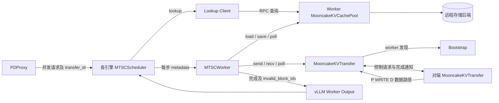
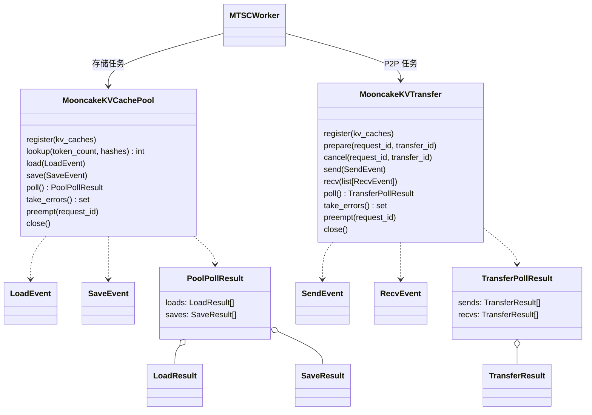
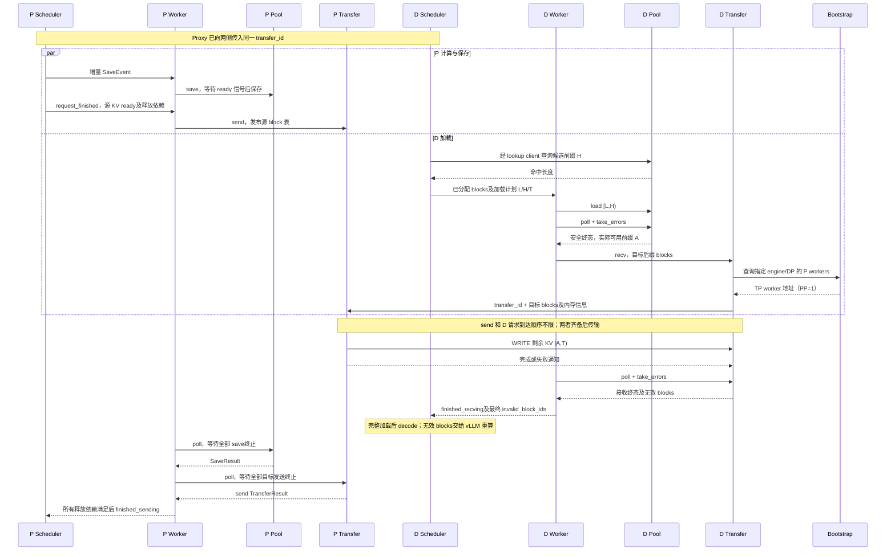

# MTSC MooncakeKVCachePool 与 MooncakeKVTransfer 设计

> 上位文档：[S00-整体设计](./S00-整体设计.md)  
> 正式接口：[kv_cache_pool.py](../../mtsc/kv_cache_pool.py)、[kv_transfer.py](../../mtsc/kv_transfer.py)

本文描述 `MooncakeKVCachePool` 与 `MooncakeKVTransfer` 的实现。
Worker 直接调用这两个具体类，不再经过独立 ABC。具体类持有 Store key metadata、
内存注册、bootstrap 和底层 I/O。

## 1. 背景

MTSC 已通过 scheduler/worker 串联远程缓存和 P-D 直传：D 先加载远程缓存的命中前缀，再请求 P 补齐剩余 KV；P、D 均可保存计算产生的 KV。目前两条路径直接依赖 Mooncake Store 和 Transfer Engine，接口中还混合了存储任务完成与 request 结束后的 block 释放逻辑。

在保留现有两阶段加载、增量保存和安全回收行为的前提下，需要把 external 能力拆成两个独立接口：

- `MooncakeKVCachePool`：远程 KV 缓存的包装层，当前使用 Mooncake Store。
- `MooncakeKVTransfer`：worker 间已有 KV 的直接传输，当前采用 D 发起请求、P WRITE D。

目标是：接口只传必要元数据，不复制 KV tensor；调用方不维护 task ID 映射；队列、线程、Future 和底层 I/O 由实现选择。request 调度、block 分配和最终释放仍由 Connector 与 vLLM 管理。

当前实现仅保留运行时需要的状态。Pool 通过 `_loads[request_id] -> _LoadState`
统一保存不可变 `LoadEvent`、Future、起始时间和超时标记；GET/PUT 后台任务直接
消费 `LoadEvent` / `SaveEvent`，不重建 Scheduler 的 request metadata。
Transfer 的接收完成通过原生的 `finished_recving_reqs` 收取，`_failed_recv` 补充失败信息；
接收 metadata、完成集合、错误集合及抢占等待使用的 `asyncio.Future` 全部由 `receiver_loop` 管理。
主线程只向该 loop 提交操作并取得结果，不再维护接收状态的跨线程锁。
`reqs_need_send[transfer_id]` 保存与原生一致的 `SendBlockMeta`，由 `sender_loop`
独占读写。`ready` 是 `asyncio.Event`，`need_send` / `sent` / `sending` 分别记录
配对数、成功数和正在执行的发送数。成功发送达到 `need_send` 后移除 metadata，
并通过 `finished_sending_reqs` 上报完成；失败请求在没有在途发送时由超时回收。
不维护逐目标 Future、重复请求描述符或独立 terminal 计数。
Scheduler 的 save metadata 使用 hashes 和 token 区间，不复制完整 token IDs。

## 2. 总体设计

### 2.1 核心特性

1. **存储与传输分离**：Pool 不处理 P-D 路由，Transfer 不处理缓存命中和持久化。
2. **按 request 管理**：结果直接携带本地 `request_id`；`transfer_id` 只用于跨 P/D 匹配。
3. **异步提交、非阻塞轮询**：load/save/send/recv 返回 `None`，通过 `poll()` 收取结果，即时完成也走同一通道。
4. **增量 save 合并**：同一 request 可多次保存，合并安全的 pending 范围，减少排队任务和存储调用。
5. **完成与成功分离**：失败也必须等相关内存访问停止后才报告完成；无效目标 block 单独上报。
6. **单写者与安全回收**：Pool load 终止后才启动 P WRITE；最终 block 释放需要满足 request 的所有依赖。

### 2.2 架构设计



图中 Worker/Transfer 节点代表本地与对端实例，实际 KV 数据方向固定为 P 到 D。scheduler 的查询通过轻量 lookup client 访问 worker Pool，不在 scheduler 初始化完整的 GPU I/O 对象。

### 2.3 组件职责

| 组件 | 职责 |
|---|---|
| `PDProxy` | 选择 P/D，向两侧传入同一 `transfer_id`，向 D 提供 P 的 bootstrap、engine 和 DP 身份 |
| `MTSCConnector` | 适配 vLLM hooks，将 scheduler/worker 的完成和错误状态接入 vLLM |
| `MTSCScheduler` | 查询可用前缀，绑定分配的 blocks，生成增量 metadata，决定 request 结束时的释放依赖 |
| Lookup Client | 包装查询 RPC 与可选的异步等待，隔离 scheduler 和 worker 的进程边界 |
| `MTSCWorker` | 编排 Pool-first 两阶段加载，收取结果，处理 fallback，聚合 request 的 block 释放条件 |
| `MooncakeKVCachePool` | 注册本地 KV 内存，查询远程缓存，执行 load/save，管理 pending 合并及存储任务的安全终态 |
| `MooncakeKVTransfer` | 注册传输内存与 endpoint，发现 P workers，匹配 send/recv，校验布局与覆盖，执行直传 |

### 2.4 类图



事件和结果均为简单 dataclass；Pool 和传输都直接使用具体类。传输状态机与 Future 不对调用方暴露。

### 2.5 核心方法

| 方法 | 核心行为 |
|---|---|
| `register()` | 注册本地 KV tensor；group、layout、topology 等静态信息由后端初始化配置提供 |
| Pool `lookup()` | 只查询远程可用前缀，不分配 block、不搬运数据 |
| Pool `load()` | 将指定 token 范围加载到已分配 block，通常每个 allocation 生命周期一个逻辑任务 |
| Pool `save()` | 接收增量保存范围，同 request 的 pending 工作在安全条件下合并 |
| Transfer `prepare()` / `cancel()` | 登记尚未 ready 的 P 请求；移除发送 metadata，等待在途源读取结束 |
| Transfer `send()` | P 发布已经 ready 的源 block 表，等待 D 请求后发送 |
| Transfer `recv()` | D 按批提交目标 block 表，同一 engine 的请求合并发送给配对 P workers，按请求等待写入终态 |
| `poll()` / `take_errors()` | 收取安全终态与无效目标 block；Worker 决定 fallback 或最终上报 |
| `preempt()` / `close()` | 停止或等待相关 I/O，内存访问终止后才允许复用 block 或释放资源 |

### 2.6 E2E 时序图



P、D 均可独立 lookup/load/save。图中突出 D 两阶段加载和 P 源 block 释放；D decode 期间的增量 save 复用同一 Pool 协议。

## 3. 详细设计

### 3.1 数据契约

`BlockIds = tuple[tuple[int, ...], ...]`：外层按 KV group 排列，内层是有序的本地物理 block ID。事件使用不可变元数据快照，KV tensor 在注册后保持有效。

| 结构 | 必要字段与含义 |
|---|---|
| `LoadEvent` | `request_id`、完整 `block_ids` / `block_hashes`、token 范围 `[start_load,end_load)` |
| `SaveEvent` | `request_id`、完整 `block_ids` / `block_hashes`、token 范围 `[start_save,end_save)`、可选 `ready_event` / `prompt_tokens`（用于 hybrid 保存 mask） |
| `LoadResult` | `request_id`、实际可用前缀终点 `loaded_tokens`、可选 `error` |
| `SaveResult` | `request_id`、本轮聚合保存的可选 `error` |
| `SendEvent` | 本地 `request_id`、跨侧 `transfer_id`、完整源 `block_ids` |
| `RecvEvent` | 本地 `request_id`、`transfer_id`、仅待接收的目标 `block_ids`、`bootstrap_addr`、`remote_engine_id`、`remote_dp_rank` |
| `TransferResult` | 本地 `request_id`、可选 `error`；由 sends/recvs 列表区分方向 |

Pool 根据 block hash 和静态布局配置生成存储 key；Transfer 不传 block hash，直接根据会话和物理 block 定位数据。`request_id` 不能在旧任务、结果或 block 错误尚未清理时复用。

### 3.2 Lookup 与单次 Load

`lookup(token_count, hashes) -> int` 返回远程可用的逻辑前缀长度，miss 返回 0，后端异常抛出。scheduler 侧的 client 可异步包装查询，并将查询失败按 miss 降级。lookup 结果是候选值，不能保证数据在 load 时仍存在。

一次 load 可以包含多个 group/chunk 子任务，推荐内部维护 `request_id -> load future`，由该 future 聚合全部子任务。`poll()` 必须等全部子任务终止，包括失败任务，保证不会继续写入目标内存，再返回一个 `LoadResult`。

Worker 根据实际终点 `A = loaded_tokens` 决定 PD 后缀，不能使用候选终点 H 提前启动 WRITE：

```text
0 <= L <= A <= H <= T
Pool load: [L,H)    实际可用前缀截至 A
P2P WRITE: [A,T)    覆盖剩余后缀及需要重写的 blocks
```

`loaded_tokens` 包含已有本地前缀 L；有效性按各 group 的缓存规则解释。加载失败 blocks 在同轮 `take_errors()` 收取，Worker 过滤被 PD 成功恢复的 blocks，只向 scheduler 上报最终无效部分。

### 3.3 增量 Save 与合并

Scheduler 的保存终点取本轮预计计算终点与真实 `Request.num_tokens` 的较小值，再向下对齐完整 block。
这与原生 Mooncake Store 按 `all_token_ids` 的实际长度推进一致：MTP 未验收草稿和异步输出占位
不会提前推进 `saved_tokens`。草稿被接受后进入真实序列，可在后续调度中增量保存。

同一 request 随 prefill/decode 进展可提交多个 save。推荐内部维护 `request_id -> save state`，包含 running 工作、pending events 和累计错误。常见连续范围只需一个 running 和一个合并后的 pending；不满足合并条件的快照保留独立工作。

```text
running: [0,64)
pending: [64,96) + [96,128) -> [64,128)
```

合并只修改 pending 元数据，不能改变执行中的快照。范围必须连续或重叠，最新 block/hash 表必须覆盖合并范围且保留原 token 到源 block 的对应关系；等待的 ready 信号必须覆盖全部源数据。不能跨抢占或 block 复用合并。只有完整且 ready 的缓存 chunk 被保存。

`SaveResult` 覆盖上一次结果收取后接受的全部 save。返回条件是 **所有相关工作终止、没有 pending event、没有源内存读取**，不能只检查现有 futures。较早的错误不能被后续成功覆盖；结果收取前新到达的 save 会扩展待完成工作，`poll()` 必须重新检查，避免返回过期完成状态。

request 继续运行时可多次收到 `SaveResult`，之后也可继续 save。Pool 不需要 `finish(request_id)`；request 结束与最终 block 释放由 Worker 聚合。

### 3.4 D 发起请求、P WRITE

1. P 在 KV 可被传输层安全读取后调用 `send()`，发布 ready 的完整源 block 表；此调用不等待接收方或 I/O。
2. D 将同一 Worker 轮次可直传的请求组成 `list[RecvEvent]`，一次调用 `recv()`。接收循环按 `remote_engine_id` 分组，首次发现 engine 时查询 bootstrap；每组向各匹配 P worker 发送一条包含多个请求的控制消息。各组并发推进，组内请求按 ready 情况分别完成，不等待整组一起完成。
3. P 的 `_sender_listener()` 对齐 vLLM MooncakeConnector：控制消息进入无容量上限的 `sender_worker_queue`，由 `2 * num_workers` 个固定发送协程处理。消息中的请求同时等待源 ready，每轮将已 ready 请求的地址数组合并，调用一次 TE WRITE；未 ready 的请求继续等待，不阻塞该消息内已 ready 请求。
4. 源和目标 block 同时连续、两侧 offset 为零且复制覆盖完整物理 block 时，将连续 block 合为较大的传输描述符；TP 切片、半页及 padding 不满足条件时逐 block 复制。
5. P 每轮返回 `ok_reqs` / `err_reqs`（D request IDs）；还有 pending 请求时状态为 `CONTINUE`，整条消息处理完为 `FINISH`，整批异常为 `ERROR`。D 按请求统计所有必要 P worker 的终态，完成本地布局转换后报告完成。P 保留全部目标终态聚合及源访问 fence。

发送线程池默认 `num_workers=10`，固定发送协程默认 20；没有额外 Semaphore、跨控制消息的 session 合并或收集窗口。原生 WRITE 接收完整批次，不再增加 TCP 专用分段和同 peer 串行层。TCP 仍要求接收端 ACK。控制消息字段与官方 Mooncake 一致，P/D 必须一起升级。

事件循环按角色创建：支持 `kv_producer`、`kv_consumer`、`kv_both`。P 使用 `sender_loop`、`_sender_listener_t` 和
`_sender_executor`，负责 listener、等待源 KV 和执行 WRITE；D 使用
`receiver_loop`、`_receiver_t`，负责发现 P、提交拉取请求和处理响应。
纯 D 不创建发送线程池及 sender queue；`kv_both` 同时创建两侧资源。关闭时先等在途内存访问结束，再在所属
事件循环销毁 ZMQ context，最后停止对应线程和事件循环。

源和目标必须对应同一前缀终点，group/block 布局兼容；当前不支持任意中间区间。send 与 D 控制请求谁先到都可等待匹配。D 成功结果必须包含必要的本地布局转换与设备同步。目标为空时不搬运 KV，但仍需会话确认，使 P 能结束源会话；这一已有行为需在后端适配时保留。

### 3.5 完成、错误与 Block 生命周期

`poll()` 非阻塞且结果只收取一次；终态表示内存访问已停止，成功与否由结果判断。`take_errors()` 非阻塞取出并清空已轮询失败的物理目标 block ID。它只处理 load/recv 的无效目标，不因 save/send 失败而失效本地源 KV。

Worker 的 `_finished_waits` 表示 request 结束后的释放依赖，D 仅保存时也需要它。`_saving_requests` 表示生成过保存工作，不等于当前正在执行 save。

```text
finished_sending = request 已结束
                  AND 所有已提交 save 终止（如需要）
                  AND P-D send 终止（如需要）
```

中间 `SaveResult` 只更新 Worker 的保存状态，不能直接进入最终 `finished_sending`。新 save 到达后重新标记保存未完成。request 结束时没有 outstanding save 的情况，也应利用已有状态完成释放判断。

`preempt()` 可以阻塞：取消 pending 工作，fence 无法安全取消的运行任务，清理未收取结果和错误后才允许复用 block。
P 尚未 `send()` 时没有发布源内存，抢占保留早到的 D 等待者，可在恢复后用原 `transfer_id` 发布新的 ready blocks。
取消通过 `cancel(request_id, transfer_id)` 移除源 metadata 并唤醒早到的 D 等待者。
P 不保留退休 ID；调用方为每次重试提供新的 `transfer_id`，和原生 Mooncake 保持一致。
`prepare()` 将本地 request 与未 ready 的 metadata 关联；取消尚不存在的发送 metadata 无操作。D 已发布目标内存时必须等待远端写停止；timeout、取消本地 Future 或忽略迟到响应均不能单独证明安全。`close()` 同样先 fence，再释放注册内存与后端资源。

## 4. Mooncake 实现与并行映射

### 4.1 实现入口

| 功能 | 当前代码路径 |
|---|---|
| Pool/传输实现、事件与结果 | `mtsc/kv_cache_pool.py`、`mtsc/kv_transfer.py` |
| Pool 生命周期与 I/O | `mtsc/kv_cache_pool.py`：lookup RPC、官方 key、注册、GET/PUT、load 聚合、pending save 合并、错误与 fence |
| Transfer 生命周期与 I/O | `mtsc/kv_transfer.py`：bootstrap、注册、region 与 WRITE、prepare/send/recv/cancel、原生发送计数与内存访问 fence |
| Worker 编排 | `mtsc/worker.py`：消费 metadata、Pool-first、以 loaded_tokens 固化 A、聚合 request 结束后的释放依赖 |
| Backend 配置 | `mtsc/worker.py` 私有工厂：`mtsc_pool_backend` / `mtsc_transfer_backend`，默认且当前仅支持 `mooncake` |
| 共享协议 | `mtsc/protocol.py`：Scheduler/Worker metadata 与 P/D wire 结构 |
| 设备布局转换 | `mtsc/utils.py`：共享设备事件、注册区域、NZ 配置与有效 KV 分片数 |
| KV 字节分片映射 | `mtsc/kv_transfer.py`：`_compute_sender_transfer_plan()`，处理 TP 分片与复制 rank |

scheduler-worker metadata 保留现有 wire 结构，Worker 将其转换为不可变事件快照。
Pool 不接收 request-end 信息，Worker 的 `_on_save_requests` 与 `_finished_waits` 分别管理当前保存工作及最终释放依赖。
Pool 和传输都没有额外 ABC 或兼容别名，Worker 工厂的返回类型直接指向 `MooncakeKVCachePool` 与 `MooncakeKVTransfer`。

配置继续在各使用位置直接读取 vLLM，不增加独立配置对象。
Pool/Transfer 在创建 I/O 资源前校验各自超时为有限正数；PD timeout 默认取
`VLLM_MOONCAKE_ABORT_REQUEST_TIMEOUT`。线程数仍按 `max(1, int(...))` 归一化。
`lookup_rpc_port` 仅作为 IPC 路径标识。

### 4.2 Pool 并行与 MLA

Pool 直接保存 TP/PP/PCP/DCP 的 rank/size，以及 `use_mla`、`num_kv_head`、`put_step`、
`head_or_tp_rank` 和 `metadata`；数据库与 lookup 初始化使用这些属性，不再通过元组传递拓扑。

Pool 直接使用所指定 vLLM Store 的 `PoolKey.to_string()` 格式。
`_process_tokens()` 只应用 mask 与 PUT 条带化，原样返回 `database.process_tokens()` 生成的 key 对象；
GET/PUT 在 SDK 边界调用 `to_string()`。lookup 仅缓存各 rank 的 `KeyMetadata`，以相同序列化方法生成 key。
不再使用 `_database_key()`、自定义 topology namespace 或 `cache_prefix`。

Pool 不执行跨 TP/PP/PCP/DCP 布局转换；共享 Store 的实例须由部署保证 model、dtype、block/layout 和 group 兼容。
DP 是副本身份，不进入 KV 分片 key 的布局坐标。MLA 在 DCP=1 时使用有效 KV head 数 1 和共享 `tp_rank:0` key；
各 rank 按 chunk 分摊 PUT，每个 rank 均可加载完整副本，兼容布局可跨 TP size 复用。
DCP>1 时保留物理 TP rank，并使用 `put_step=1`，避免对不同 token 分片应用副本 PUT 分摊。
Store GET 恢复原始物理字节，不执行 PD 重排。

### 4.3 Transfer TP/PP/DP

Transfer 的 region、基础消息和 TP 规划对齐指定的
`workerspace/vllm/vllm/distributed/kv_transfer/kv_connector/v1/mooncake/mooncake_connector.py`。
P/D TP size 必须互为整数倍，`PP=1`；MLA 与复制型 KV 沿用原生发送方选择策略。
每个 region 仅包含 `base_addr`、`block_len`、`kv_block_len`，按注册顺序配对。
各 KV group 的源表按目标长度分别取后缀，再统一展开；每个 region 使用同一张表。
不再维护 layer/group 匹配、按 token 的 region、row offset 或 layout cache。

注册按 tensor 起始地址去重，长度为 `num_blocks * stride(0) * element_size`。
NPU 使用同样的范围逐区间注册。
非 MLA 使用 HND，以保证 KV heads 在 block 内连续；NPU NHD 的异构 TP 不再走 token 级补偿路径，
在 WRITE 前拒绝该不兼容布局。初始化调用 `select_common_block_size()` 同步实际 kernel block size。
Mamba KV cache 仍明确拒绝。

`KVTransferRequest` 只含远端 host/port、TP size/rank、`req_blocks`、base addresses 和 block strides。
响应只有 `FINISH`、`CONTINUE`、`ERROR`，不再发送 layer metadata、layout ID 或 `LAYOUT_MISS`。
`req_blocks` 和响应列表使用 D request ID，transfer ID 用于跨 P/D 匹配。
协议测试直接导入指定版本的原生消息类，对照字段、编码和实际传输描述。

D 的 `recv(events)` 一次提交一批请求；`_start_receive()` 按 engine ID 聚合
`PullReqMeta` 后，通过 `_start_load_kv()` 按 engine 检查 `_remote_agents` 缓存。首次发现由
`handle_new_engine_id()` 调用 `_connect_to_prefiller_bootstrap()`，一次 HTTP GET
缓存该 bootstrap 返回的全部 engines、worker 地址和 TP size；同一 bootstrap 的
并发查询通过 `asyncio.Event` 等待。缓存命中后直接调用同步的 `receive_kv()`，
按 TP 配对创建 `receive_kv_from_single_worker()` 任务。
`process_pulling_result()` 按各请求所需 P workers 的响应计数。
目标 engine 使用 Proxy 指定的 engine ID，不再按 DP rank 二次索引 worker 缓存。
Bootstrap 地址和启动条件沿用原生；发现失败仍向 MTSC 上层报告接收失败。

P 的登记、发布、完成收取、取消、抢占与关闭清理均使用明确的 async 方法，
主线程直接通过 `asyncio.run_coroutine_threadsafe(..., sender_loop)` 提交协程并取得结果。
`fetch_finished_sending_reqs()` 负责收取完成结果与超时回收，不再使用通用 callback 包装或跨线程锁管理发送 metadata。
发送路径按原生顺序等待 `ready`、增加 `sending`、构造传输参数、执行 TE WRITE，
成功后增加 `sent`；只有 `sent == need_send` 才移除源 metadata 并上报完成。
TE 返回失败或 block 表不匹配时向 D 报错，P metadata 保留到超时回收。
P 不再维护逐目标去重、terminal、目标 TP 快照或退休 ID。
MTSC 的取消与抢占直接移除发送 metadata，并通过 `sending` 计数等待在途源读取结束。
D 的 metadata 登记、响应处理、完成收取、错误收取和抢占清理都在 `receiver_loop` 执行。
登记、完成收取、错误收取和接收等待使用明确的 async 方法；主线程通过
`asyncio.run_coroutine_threadsafe(..., receiver_loop)` 提交协程并取得结果，不再使用通用 callback 包装。
`fetch_finished_recving_reqs()` 排空完成集合；`asyncio.Future` 只用于 loop 内等待在途接收结束。
不再使用 `_receive_lock` 或 `_result_lock`。关闭先排空两侧 I/O，再销毁共享 ZMQ context。
listener 创建的发送 worker task 使用原生名称 `sender_tasks`。

当前不采集传输统计；直接调用 TE WRITE。Connector 沿用 vLLM 基类的统计接口，返回 `None`。

直传 TE 的协议/网卡按字段解析：extra config 的 `mooncake_protocol`/`device_name` >
Store JSON 的 `protocol`/`device_name` > 默认 `rdma`/空字符串。
`null` 视为缺省，空 `device_name` 是显式覆盖。已配置且需要读取的 JSON 无效时直接报错，
避免静默使用不同协议。该默认值共享是 MTSC 扩展，直传仍使用 `P2PHANDSHAKE`；
Store 自己的 TE 继续从 JSON 初始化。

D 使用官方的 `RCVTIMEO = (P ready timeout + 60s)`。P 的 `ERROR` / `FINISH` 是终态，可将失败目标回退重算。接收超时、断连或非终态协议异常无法证明远端 WRITE 已停止：后端记录致命错误，唤醒所有接收等待者，由 `poll()` / `preempt()` / `close()` 向 worker 抛出；不发布普通加载失败、不注销内存，等待 worker 进程终止。

## 5. 验证与后续工作

`tests/test_backends.py` 覆盖具体后端的 save 合并、ready 信号、累计错误、增量结果、部分 load、timeout、
抢占、空 recv、指定 DP 身份、多 peer fence，以及模拟 TE 字节写入的异构 TP/MLA。
`tests/test_mtsc.py` 保留原生 key、MLA key、设备注册、TP 切片、lookup、Proxy 和 legacy helper 回归测试。
`tests/test_mooncake_alignment.py` 直接执行 MTSC 与原生发送函数，对比 TP 配对、传输描述符、成功计数、失败保留和超时回收；
通过真实 receiver 线程验证登记、完成、结果收取、错误收取和抢占操作的线程归属。
`tests/test_transfer_batching.py` 覆盖 ready 合并、分轮完成、连续 block 合并、共享批次取消、失败后超时回收、部分失败隔离及 listener 退出时的 WRITE fence，并通过真实 ZMQ 控制通道和模拟 TE 校验批量拷贝。
`tests/test_review_fixes.py` 覆盖启动、Store 成功加载、HND 整块 TP 切片、NHD 异构拒绝、group 展开、padding 范围校验和直传配置优先级。
`tests/test_mooncake_alignment.py` 直接核对原生 schema/metadata 字段，验证 kernel block size、sender 状态线程归属、
真实 ZMQ 双向 `kv_both` 和统计导出；TE 数据拷贝使用 CPU 模拟。
`tests/test_official_transfer.py` 对比多 group 裁剪、展开和异构 TP 的原生传输描述，并验证空 group、group 数量不匹配和 Mamba 拒绝路径。
`tests/test_store_keys.py` 对照指定 vLLM 的 key 生成结果，并验证多 group 的 lookup/PUT/GET 使用相同 key。
这些测试不代表真实 Mooncake/GPU E2E 已通过。

后续验证：真实 GPU/Mooncake 的同构及异构 TP E2E、MLA 模型与 Ascend 实机验证；
替代 Pool 后端可按现有方法签名另行实现，并显式接入 Worker 工厂。非整数倍 TP 和跨 Pool 布局复用不在本版范围。
