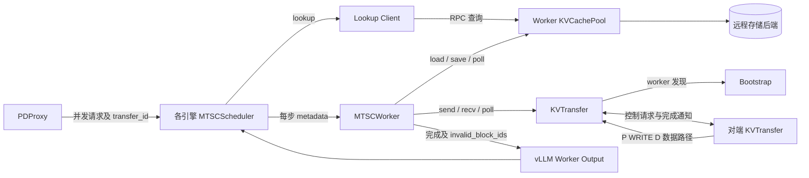
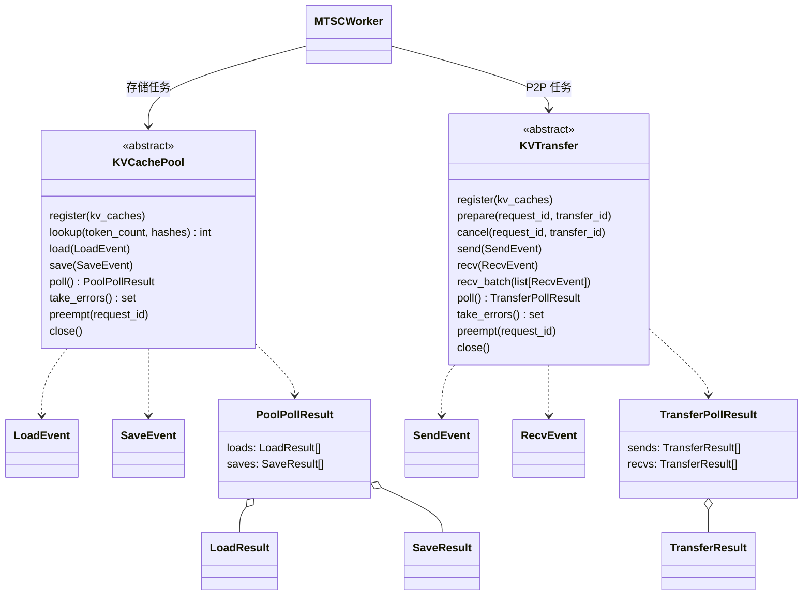
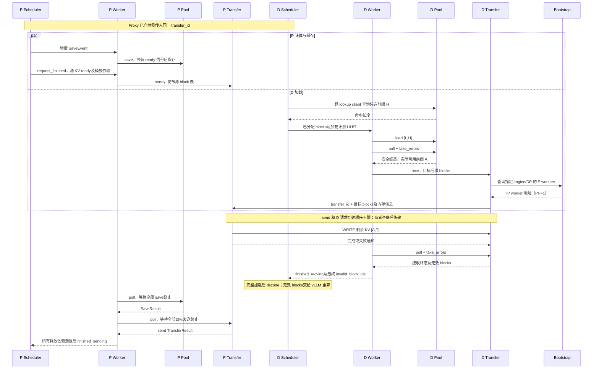

# MTSC KVCachePool 与 KVTransfer 设计

> 上位文档：[S00-整体设计](./S00-整体设计.md)  
> 正式接口：[kv_cache_pool.py](../../mtsc/kv_cache_pool.py)、[kv_transfer.py](../../mtsc/kv_transfer.py)

本文定义外部 KV 能力的抽象契约，现已由 `MooncakeKVCachePool(KVCachePool)` 和
`MooncakeKVTransfer(KVTransfer)` 实现。接口与对应 Mooncake 实现放在同一个模块中，
具体类持有 Store key metadata、内存注册、bootstrap 和底层 I/O；Worker 通过 ABC 提交事件和消费结果。

## 1. 背景

MTSC 已通过 scheduler/worker 串联远程缓存和 P-D 直传：D 先加载远程缓存的命中前缀，再请求 P 补齐剩余 KV；P、D 均可保存计算产生的 KV。目前两条路径直接依赖 Mooncake Store 和 Transfer Engine，接口中还混合了存储任务完成与 request 结束后的 block 释放逻辑。

在保留现有两阶段加载、增量保存和安全回收行为的前提下，需要把 external 能力拆成两个独立接口：

- `KVCachePool`：远程 KV 缓存的包装层，后端可选 Mooncake Store、MongoDB、FileSystem 等。
- `KVTransfer`：worker 间已有 KV 的直接传输，当前采用 D 发起请求、P WRITE D。

目标是：接口只传必要元数据，不复制 KV tensor；调用方不维护 task ID 映射；队列、线程、Future 和底层 I/O 由实现选择。request 调度、block 分配和最终释放仍由 Connector 与 vLLM 管理。

当前实现仅保留运行时需要的状态。Pool 通过 `_loads[request_id] -> _LoadState`
统一保存不可变 `LoadEvent`、Future、起始时间和超时标记；GET/PUT 后台任务直接
消费 `LoadEvent` / `SaveEvent`，不重建 Scheduler 的 request metadata。
Transfer 的 receive 终态以 Future 为准，`_failed_recv` 只补充失败信息；
`_pending_sends` 仅记录尚未收取结果的 request IDs，源 blocks 由 `_Session` 持有。
Scheduler 的 save metadata 使用 hashes 和 token 区间，不复制完整 token IDs。

## 2. 总体设计

### 2.1 核心特性

1. **存储与传输分离**：Pool 不处理 P-D 路由，Transfer 不处理缓存命中和持久化。
2. **按 request 管理**：结果直接携带本地 `request_id`；`transfer_id` 只用于跨 P/D 匹配。
3. **异步提交、非阻塞轮询**：load/save/send/recv 返回 `None`，通过 `poll()` 收取结果，即时完成也走同一通道。
4. **增量 save 合并**：同一 request 可多次保存，合并安全的 pending 范围，减少排队任务和存储调用。
5. **完成与成功分离**：失败也必须等相关内存访问停止后才报告完成；无效目标 block 单独上报。
6. **单写者与安全回收**：Pool load 终止后才启动 P WRITE；最终 block 释放需要满足 request 的所有依赖。

### 2.2 架构设计



图中 Worker/Transfer 节点代表本地与对端实例，实际 KV 数据方向固定为 P 到 D。scheduler 的查询通过轻量 lookup client 访问 worker Pool，不在 scheduler 初始化完整的 GPU I/O 对象。

### 2.3 组件职责

| 组件 | 职责 |
|---|---|
| `PDProxy` | 选择 P/D，向两侧传入同一 `transfer_id`，向 D 提供 P 的 bootstrap、engine 和 DP 身份 |
| `MTSCConnector` | 适配 vLLM hooks，将 scheduler/worker 的完成和错误状态接入 vLLM |
| `MTSCScheduler` | 查询可用前缀，绑定分配的 blocks，生成增量 metadata，决定 request 结束时的释放依赖 |
| Lookup Client | 包装查询 RPC 与可选的异步等待，隔离 scheduler 和 worker 的进程边界 |
| `MTSCWorker` | 编排 Pool-first 两阶段加载，收取结果，处理 fallback，聚合 request 的 block 释放条件 |
| `KVCachePool` | 注册本地 KV 内存，查询远程缓存，执行 load/save，管理 pending 合并及存储任务的安全终态 |
| `KVTransfer` | 注册传输内存与 endpoint，发现 P workers，匹配 send/recv，校验布局与覆盖，执行直传 |

### 2.4 类图



事件和结果均为简单 dataclass；后端实现继承相应 ABC。传输状态机与 Future 不对调用方暴露。

### 2.5 核心方法

| 方法 | 核心行为 |
|---|---|
| `register()` | 注册本地 KV tensor；group、layout、topology 等静态信息由后端初始化配置提供 |
| Pool `lookup()` | 只查询远程可用前缀，不分配 block、不搬运数据 |
| Pool `load()` | 将指定 token 范围加载到已分配 block，通常每个 allocation 生命周期一个逻辑任务 |
| Pool `save()` | 接收增量保存范围，同 request 的 pending 工作在安全条件下合并 |
| Transfer `prepare()` / `cancel()` | 登记尚未 ready 的 P 会话；永久取消并拒绝迟到请求 |
| Transfer `send()` | P 发布已经 ready 的源 block 表，等待 D 请求后发送 |
| Transfer `recv()` / `recv_batch()` | D 发现目标 P workers，批量提交目标 block 表，等待 P 写入和各请求终态通知 |
| `poll()` / `take_errors()` | 收取安全终态与无效目标 block；Worker 决定 fallback 或最终上报 |
| `preempt()` / `close()` | 停止或等待相关 I/O，内存访问终止后才允许复用 block 或释放资源 |

### 2.6 E2E 时序图



P、D 均可独立 lookup/load/save。图中突出 D 两阶段加载和 P 源 block 释放；D decode 期间的增量 save 复用同一 Pool 协议。

## 3. 详细设计

### 3.1 数据契约

`BlockIds = tuple[tuple[int, ...], ...]`：外层按 KV group 排列，内层是有序的本地物理 block ID。事件使用不可变元数据快照，KV tensor 在注册后保持有效。

| 结构 | 必要字段与含义 |
|---|---|
| `LoadEvent` | `request_id`、完整 `block_ids` / `block_hashes`、token 范围 `[start_load,end_load)` |
| `SaveEvent` | `request_id`、完整 `block_ids` / `block_hashes`、token 范围 `[start_save,end_save)`、可选 `ready_event` / `prompt_tokens`（用于 hybrid 保存 mask） |
| `LoadResult` | `request_id`、实际可用前缀终点 `loaded_tokens`、可选 `error` |
| `SaveResult` | `request_id`、本轮聚合保存的可选 `error` |
| `SendEvent` | 本地 `request_id`、跨侧 `transfer_id`、完整源 `block_ids` |
| `RecvEvent` | 本地 `request_id`、`transfer_id`、仅待接收的目标 `block_ids`、`bootstrap_addr`、`remote_engine_id`、`remote_dp_rank` |
| `TransferResult` | 本地 `request_id`、可选 `error`；由 sends/recvs 列表区分方向 |

Pool 根据 block hash 和静态布局配置生成存储 key；Transfer 不传 block hash，直接根据会话和物理 block 定位数据。`request_id` 不能在旧任务、结果或 block 错误尚未清理时复用。

### 3.2 Lookup 与单次 Load

`lookup(token_count, hashes) -> int` 返回远程可用的逻辑前缀长度，miss 返回 0，后端异常抛出。scheduler 侧的 client 可异步包装查询，并将查询失败按 miss 降级。lookup 结果是候选值，不能保证数据在 load 时仍存在。

一次 load 可以包含多个 group/chunk 子任务，推荐内部维护 `request_id -> load future`，由该 future 聚合全部子任务。`poll()` 必须等全部子任务终止，包括失败任务，保证不会继续写入目标内存，再返回一个 `LoadResult`。

Worker 根据实际终点 `A = loaded_tokens` 决定 PD 后缀，不能使用候选终点 H 提前启动 WRITE：

```text
0 <= L <= A <= H <= T
Pool load: [L,H)    实际可用前缀截至 A
P2P WRITE: [A,T)    覆盖剩余后缀及需要重写的 blocks
```

`loaded_tokens` 包含已有本地前缀 L；有效性按各 group 的缓存规则解释。加载失败 blocks 在同轮 `take_errors()` 收取，Worker 过滤被 PD 成功恢复的 blocks，只向 scheduler 上报最终无效部分。

### 3.3 增量 Save 与合并

同一 request 随 prefill/decode 进展可提交多个 save。推荐内部维护 `request_id -> save state`，包含 running 工作、pending events 和累计错误。常见连续范围只需一个 running 和一个合并后的 pending；不满足合并条件的快照保留独立工作。

```text
running: [0,64)
pending: [64,96) + [96,128) -> [64,128)
```

合并只修改 pending 元数据，不能改变执行中的快照。范围必须连续或重叠，最新 block/hash 表必须覆盖合并范围且保留原 token 到源 block 的对应关系；等待的 ready 信号必须覆盖全部源数据。不能跨抢占或 block 复用合并。只有完整且 ready 的缓存 chunk 被保存。

`SaveResult` 覆盖上一次结果收取后接受的全部 save。返回条件是 **所有相关工作终止、没有 pending event、没有源内存读取**，不能只检查现有 futures。较早的错误不能被后续成功覆盖；结果收取前新到达的 save 会扩展待完成工作，`poll()` 必须重新检查，避免返回过期完成状态。

request 继续运行时可多次收到 `SaveResult`，之后也可继续 save。Pool 不需要 `finish(request_id)`；request 结束与最终 block 释放由 Worker 聚合。

### 3.4 D 发起请求、P WRITE

1. P 在 KV 可被传输层安全读取后调用 `send()`，发布 ready 的完整源 block 表；此调用不等待接收方或 I/O。
2. D 将同一 Worker 轮次可直传的请求通过 `recv_batch()` 提交；后端按 bootstrap、engine、DP 分组，派生 TP 配对，将多个 transfer_id 合成一条发往各匹配 P worker 的控制消息。`recv()` 等价于单请求批次。
3. P 对齐 vLLM MooncakeConnector：控制消息进入无容量上限的 `sender_worker_queue`，由 `2 * num_workers` 个固定发送协程处理。消息中的请求同时等待源 ready，每轮将已 ready 请求的地址数组合并，调用一次 TE WRITE；未 ready 的请求继续等待，不阻塞该消息内已 ready 请求。
4. 源和目标 block 同时连续、两侧 offset 为零且复制覆盖完整物理 block 时，将连续 block 合为较大的传输描述符；TP 切片、半页及 padding 不满足条件时逐 block 复制。
5. P 每轮返回 `ok_reqs` / `err_reqs`（D request IDs）；还有 pending 请求时状态为 `CONTINUE`，整条消息处理完为 `FINISH`，整批异常为 `ERROR`。D 按请求统计所有必要 P worker 的终态，完成本地布局转换后报告完成。P 保留全部目标终态聚合及源访问 fence。

发送线程池默认 `num_workers=10`，固定发送协程默认 20；没有额外 Semaphore、跨控制消息的 session 合并或收集窗口。原生 WRITE 接收完整批次，不再增加 TCP 专用分段和同 peer 串行层。TCP 仍要求接收端 ACK。控制消息字段与官方 Mooncake 一致，P/D 必须一起升级。

源和目标必须对应同一前缀终点，group/block 布局兼容；当前不支持任意中间区间。send 与 D 控制请求谁先到都可等待匹配。D 成功结果必须包含必要的本地布局转换与设备同步。目标为空时不搬运 KV，但仍需会话确认，使 P 能结束源会话；这一已有行为需在后端适配时保留。

### 3.5 完成、错误与 Block 生命周期

`poll()` 非阻塞且结果只收取一次；终态表示内存访问已停止，成功与否由结果判断。`take_errors()` 非阻塞取出并清空已轮询失败的物理目标 block ID。它只处理 load/recv 的无效目标，不因 save/send 失败而失效本地源 KV。

Worker 的 `_finished_waits` 表示 request 结束后的释放依赖，D 仅保存时也需要它。`_saving_requests` 表示生成过保存工作，不等于当前正在执行 save。

```text
finished_sending = request 已结束
                  AND 所有已提交 save 终止（如需要）
                  AND P-D send 终止（如需要）
```

中间 `SaveResult` 只更新 Worker 的保存状态，不能直接进入最终 `finished_sending`。新 save 到达后重新标记保存未完成。request 结束时没有 outstanding save 的情况，也应利用已有状态完成释放判断。

`preempt()` 可以阻塞：取消 pending 工作，fence 无法安全取消的运行任务，清理未收取结果和错误后才允许复用 block。
P 尚未 `send()` 时没有发布源内存，抢占保留早到的 D 等待者，可在恢复后用原 `transfer_id` 发布新的 ready blocks。
永久取消必须通过 `cancel(request_id, transfer_id)` 结束该会话；已发布 send/recv 的尝试则退休 ID，后续重试使用新 ID。
`prepare()` 将本地 request 与未 ready 的会话关联，也允许 `cancel()` 在尚未 prepare 时退休指定 ID。D 已发布目标内存时必须等待远端写停止；timeout、取消本地 Future 或忽略迟到响应均不能单独证明安全。`close()` 同样先 fence，再释放注册内存与后端资源。

## 4. Mooncake 实现与并行映射

### 4.1 实现入口

| 功能 | 当前代码路径 |
|---|---|
| 正式 ABC、事件与结果 | `mtsc/kv_cache_pool.py`、`mtsc/kv_transfer.py` |
| Pool 生命周期与 I/O | `mtsc/kv_cache_pool.py`：lookup RPC、官方 key、注册、GET/PUT、load 聚合、pending save 合并、错误与 fence |
| Transfer 生命周期与 I/O | `mtsc/kv_transfer.py`：bootstrap、注册、layer/group region 与 WRITE、prepare/send/recv/cancel、去重、退休 ID 与 fence |
| Worker 编排 | `mtsc/worker.py`：消费 metadata、Pool-first、以 loaded_tokens 固化 A、聚合 request 结束后的释放依赖 |
| Backend 配置 | `mtsc/worker.py` 私有工厂：`mtsc_pool_backend` / `mtsc_transfer_backend`，默认且当前仅支持 `mooncake` |
| 共享协议 | `mtsc/protocol.py`：Scheduler/Worker metadata 与 P/D wire 结构 |
| 设备布局转换 | `mtsc/utils.py`：共享设备事件、注册区域、NZ 配置与有效 KV 分片数 |
| KV 字节分片映射 | `mtsc/kv_transfer.py`：`_compute_sender_transfer_plan()`，处理 TP 分片与复制 rank |

scheduler-worker metadata 保留现有 wire 结构，Worker 将其转换为不可变事件快照。
Pool 不接收 request-end 信息，Worker 的 `_on_save_requests` 与 `_finished_waits` 分别管理当前保存工作及最终释放依赖。
两个 Mooncake 类直接实现 ABC；旧的任务生命周期、完成 API 和兼容导出已移除。

配置继续在各使用位置直接读取 vLLM，不增加独立配置对象。
Pool/Transfer 在创建 I/O 资源前校验各自超时为有限正数；PD timeout 默认取
`VLLM_MOONCAKE_ABORT_REQUEST_TIMEOUT`。线程数仍按 `max(1, int(...))` 归一化。
`lookup_rpc_port` 仅作为 IPC 路径标识。

### 4.2 Pool 并行与 MLA

Pool 直接保存 TP/PP/PCP/DCP 的 rank/size，以及 `use_mla`、`num_kv_head`、`put_step`、
`head_or_tp_rank` 和 `metadata`；数据库与 lookup 初始化使用这些属性，不再通过元组传递拓扑。

Pool 直接使用所指定 vLLM Store 的 `PoolKey.to_string()` 格式。
`_process_tokens()` 只应用 mask 与 PUT 条带化，原样返回 `database.process_tokens()` 生成的 key 对象；
GET/PUT 在 SDK 边界调用 `to_string()`。lookup 仅缓存各 rank 的 `KeyMetadata`，以相同序列化方法生成 key。
不再使用 `_database_key()`、自定义 topology namespace 或 `cache_prefix`。

Pool 不执行跨 TP/PP/PCP/DCP 布局转换；共享 Store 的实例须由部署保证 model、dtype、block/layout 和 group 兼容。
DP 是副本身份，不进入 KV 分片 key 的布局坐标。MLA 在 DCP=1 时使用有效 KV head 数 1 和共享 `tp_rank:0` key；
各 rank 按 chunk 分摊 PUT，每个 rank 均可加载完整副本，兼容布局可跨 TP size 复用。
DCP>1 时保留物理 TP rank，并使用 `put_step=1`，避免对不同 token 分片应用副本 PUT 分摊。
Store GET 恢复原始物理字节，不执行 PD 重排。

### 4.3 Transfer TP/PP/DP

Transfer 采用官方物理 TP 切片规则，P/D TP size 必须互为整数倍，且 `PP=1`。
TP 规划与 region 对齐算法跟踪 vLLM `da9134bc89364465f68aa679564435936d157a14`。
MLA 使用复制策略，普通注意力按有效 KV head 数处理分片和 GQA 复制 rank，支持跨越 head 数边界。
每个 region 保存地址、block stride、payload 长度、layer name/index、group/shared groups 和 row offset。
双方按 layer name 与出现次数配对；每个 region 只对其 group 的 source/destination blocks 做连续分组。
共享 packed row 只合并真正共用该 region 的 group，独立 group 不互相复制。
NPU NHD 按 token 暴露 head-contiguous region，双向异构 TP 均无需接收后重排；
HND 可直接切片，NZ 异构 head 重分片及 padding/NVFP4 不支持的布局在 WRITE 前回退。

DP 使用 Proxy 指定的 engine/DP 选择 P 副本。控制消息 `req_blocks` 的键为 D request ID，值为 `(transfer_id, block_groups)`。
Bootstrap 地址和启动条件沿用官方：local engines 使用 `127.0.0.1`，其余使用 `data_parallel_master_ip`；仅当 `is_local_first_rank()` 且为 local engines 或 DP index 0 时启动服务。
D 按去掉末尾斜杠的 bootstrap 地址合并在途查询，不同 engine/DP 的并发首次查询共享一次 HTTP GET，随后分别校验副本身份并缓存 worker 地址。查询失败或发起者取消时通知全部等待者并清理 pending 状态，允许后续重试；单个等待者取消不影响共享查询。
消息包含上游 `kv_block_lens`、layer/group/shared-group/row-offset 元数据。
D 每次发送完整布局，`layout_id=0`；P 支持缓存上游非零 layout ID，并在缺失时返回 `LAYOUT_MISS`。
协议校验 layer/group 及 payload 长度；model、dtype、layout 和 PCP/DCP 配置须由部署保持兼容。

MTSC 保留 transfer attempt 去重和在途 I/O 等待：重复目标等待原 WRITE，同一目标更改 destination 描述会失败。
退休 ID 保留到 close，阻止迟到请求读取已释放 blocks。整批校验失败时，先等该批已有目标的 WRITE 结束，再回复 `ERROR`。
D 的全部必要 P worker 返回成功后才完成对应请求；任一失败会使目标 blocks 进入 recompute。
源超时不能结束 active WRITE；空目标仍完成控制握手。抢占、取消和关闭均先等在途 I/O 终止，再释放内存。
CUDA 按底层 storage 去重注册，传输 payload 与 block stride 分开描述；dense packed layer 保留独立 region，
不连续 packed view 按上游规则合并为共享 row。NPU 注册区间覆盖 strided view 的物理跨度并保留合并逻辑。
直传 TE 的协议/网卡按字段解析：extra config 的 `mooncake_protocol`/`device_name` >
Store JSON 的 `protocol`/`device_name` > 默认 `rdma`/空字符串。
`null` 视为缺省，空 `device_name` 是显式覆盖。已配置且需要读取的 JSON 无效时直接报错，
避免静默使用不同协议。该默认值共享是 MTSC 扩展，直传仍使用 `P2PHANDSHAKE`；
Store 自己的 TE 继续从 JSON 初始化。

D 使用官方的 `RCVTIMEO = (P ready timeout + 60s)`。P 的 `ERROR` / `FINISH` 是终态，可将失败目标回退重算。接收超时、断连或非终态协议异常无法证明远端 WRITE 已停止：后端记录致命错误，唤醒所有接收等待者，由 `poll()` / `preempt()` / `close()` 向 worker 抛出；不发布普通加载失败、不注销内存，等待 worker 进程终止。

## 5. 验证与后续工作

`tests/test_backends.py` 覆盖具体后端的 save 合并、ready 信号、累计错误、增量结果、部分 load、timeout、
抢占、空 recv、迟到请求、目标去重、指定 DP 身份、多 peer fence，以及模拟 TE 字节写入的异构 TP/MLA。
`tests/test_mtsc.py` 保留原生 key、MLA key、设备注册、TP 切片、lookup、Proxy 和 legacy helper 回归测试。
`tests/test_transfer_batching.py` 覆盖 ready 合并、分轮完成、连续 block 合并、共享批次取消、异常重复请求 fence、部分失败隔离及 listener 退出时的 WRITE fence，并通过真实 ZMQ 控制通道和模拟 TE 校验批量拷贝。
`tests/test_review_fixes.py` 覆盖启动、Store 成功加载、NHD/HND head 重分片、独立/共享 group、packed layer、
固定上游 schema、layout cache 与直传配置优先级。`tests/reference_mooncake.py` 固定上游 `da9134bc` wire schema。
`tests/test_store_keys.py` 对照指定 vLLM 的 key 生成结果，并验证多 group 的 lookup/PUT/GET 使用相同 key。
这些测试不代表真实 Mooncake/GPU E2E 已通过。

后续验证：真实 GPU/Mooncake 的同构及异构 TP E2E、MLA 模型与 Ascend 实机验证；
替代 Pool 后端可在相同 ABC 下另行实现。非整数倍 TP 和跨 Pool 布局复用不在本版范围。
